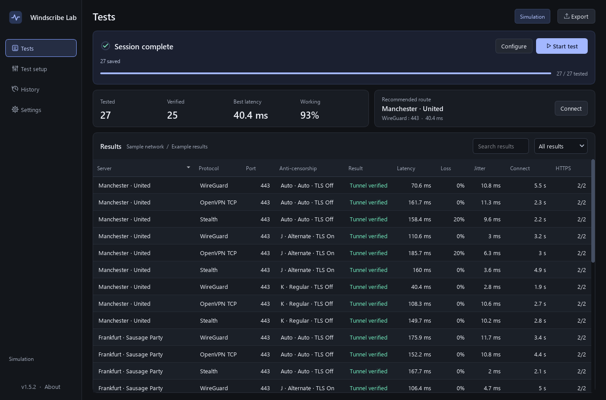
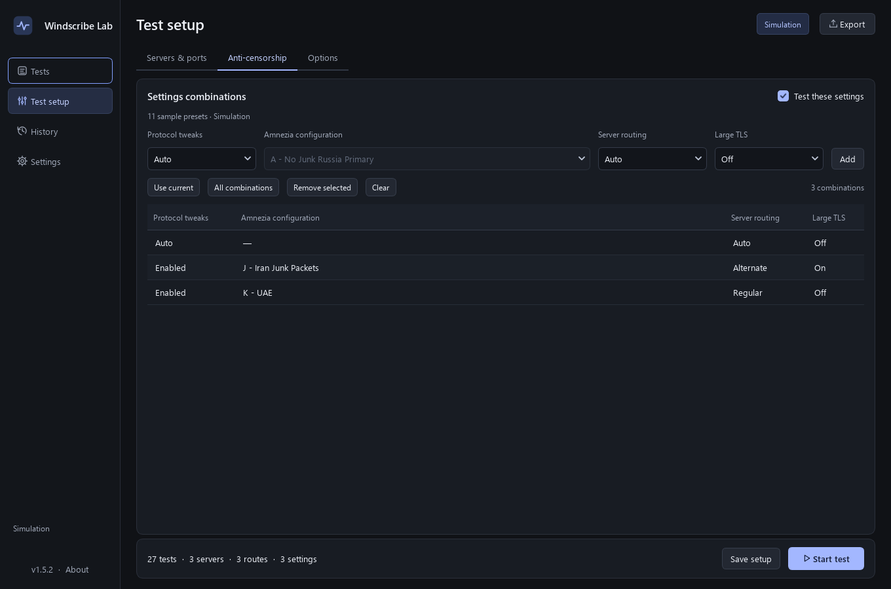

# Windscribe Lab

Find Windscribe servers, protocols, ports and anti-censorship settings that work on your network.

**[Download for Windows](https://github.com/tnt1576-a11y/windscribe-lab/releases/latest)**

Windscribe Lab uses your installed official Windscribe app. Sign in through Windscribe; Lab does not ask for your account password. This is an independent project, not affiliated with Windscribe.

## Install

1. Install the official [Windscribe desktop app](https://windscribe.com/download/) and sign in.
2. Download `WindscribeLab-1.5.2-windows-x64.zip` from the [latest release](https://github.com/tnt1576-a11y/windscribe-lab/releases/latest).
3. Extract the entire ZIP and open `WindscribeLab.exe`.

This is a portable Windows x64 app. No Python installation is needed. Keep the `_internal` folder beside the executable. The Windows executable is unsigned.

## Run a test

1. Open **Test setup → Servers & ports** and choose locations, protocols and ports. Start with a small selection.
2. Use continent or country checkboxes to select whole groups. **Select visible** selects search matches; **Clear** removes all selections.
3. In **Options**, choose the connection timeout, settle delay, repeat count and optional download sample.
4. Press **Start test**. Testing switches VPN connections and briefly interrupts internet access.
5. Use **Pause** to save progress and finish cleanup. To continue later, open the session in **History** and choose **Resume**.

The test strip shows the current server, stage and elapsed time. Completed results are saved automatically. Server access depends on your Windscribe account; some locations may be unavailable or require Pro.

## Anti-censorship settings

Open **Test setup → Anti-censorship** to compare **Protocol Tweaks**, **Amnezia configuration**, **Server Routing** and **Large TLS**. Enable **Test these settings** and add the combinations you want. **Use current** adds your current values. Check the test count before choosing **All combinations**.

Automatic settings changes currently require **Windscribe 2.24.13**. Other versions can use server/protocol/port testing where their CLI is compatible, with settings configured manually in Windscribe.

Settings changes restart Windscribe. For continuous firewall protection during restarts, use **Always On** in Windscribe. Original connection restoration is enabled by default. Settings are restored on pause or completion unless a working route is deliberately kept connected.

## Understand the results

| Result | Meaning |
| --- | --- |
| **Tunnel verified** | The requested route matched and both HTTPS checks matched the VPN IP reported by Windscribe. |
| **HTTPS only** | Both web checks passed, but VPN egress could not be confirmed. |
| **Partial HTTPS / No HTTPS** | One or both web checks failed. A blocked check service does not necessarily mean the VPN is unusable. |
| **Timed out / Connection failed** | The connection deadline was reached or the client rejected the route. |
| **Route mismatch / Unstable** | Windscribe reported a different route or the connection changed during measurement. |

Latency, jitter and loss use ICMP. Blank latency means ICMP was unavailable, not zero latency. Results describe the tested destinations at that time, not every website or app.

Use **Connect** on the recommended route, or double-click a working result, to test it and leave it connected. **Stop at first working route** also keeps the working connection active.

## Export reports

Choose **Export**, select **HTML**, **CSV** or **JSON**, then choose **All tests** or **Working servers only**.

HTML reports work offline and include search, filters, sorting, settings details, light/dark themes, filtered CSV download and print/PDF support. Working-only exports include **Tunnel verified** and **HTTPS only**, with the distinction preserved. See [the export guide](docs/EXPORTS.md).

## Recovery and privacy

If recovery needs attention, open **Test setup → Anti-censorship → Review recovery** to restore the original settings or keep the current ones. Keep the recovery backup until you have made that choice.

Live sessions are saved in `%LOCALAPPDATA%\WindscribeLab\live`. Reports contain your labels, notes and results, so review them before sharing.

There is no telemetry or automatic report upload. Tests contact Cloudflare, ipify and `1.1.1.1`; optional download samples use Cloudflare. Those services can see the source IP of their requests. Catalog refresh contacts Windscribe, and the official Windscribe app makes its normal service requests.

To explore the interface without VPN changes or test probes, run `WindscribeLab.exe --demo`.

## License

[MIT License](LICENSE) for Windscribe Lab. Bundled components retain their own licenses; see [THIRD_PARTY.md](THIRD_PARTY.md) and `licenses/`.

Windscribe and WireGuard names and trademarks belong to their respective owners.
